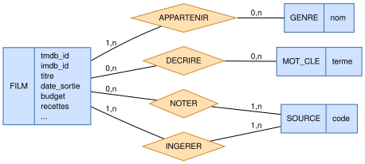

# Schémas relationnels de la base

La base « source de vérité » vient de HorRAGor1 (couche Données), modélisée
selon **Merise** en trois niveaux. HorRAGor2 y a ajouté la table
`movie_embeddings` (vecteurs `nomic-embed-text`, 768 dimensions) qui sert la
recommandation par similarité cosinus. Dans le cluster HorRAGor3, elle tourne
en conteneur PostgreSQL 17 + pgvector, restaurée depuis un dump au premier
démarrage (voir {doc}`livre`, chapitre 9).

## MCD — modèle conceptuel

Entités et associations métier, avec leurs cardinalités Merise.



| Association | Entités | Cardinalités | Attributs portés |
|---|---|---|---|
| APPARTENIR | FILM — GENRE | (1,n) — (0,n) | — |
| DÉCRIRE | FILM — MOT_CLE | (0,n) — (0,n) | — |
| NOTER | FILM — SOURCE | (0,n) — (1,n) | `score`, `audience_score`, `vote_count`, `critics_consensus` |
| INGÉRER | FILM — SOURCE | (1,n) — (1,n) | `ingested_at` |

## MLD — modèle logique

Passage au relationnel : chaque entité devient une table, les associations N-N
deviennent des tables de liaison à clé composée, les associations porteuses
d'attributs deviennent des tables dédiées (`ratings`, `sources_metadata`).

```{mermaid} bdd/mld.mmd
```

## MPD — modèle physique (base du cluster)

Le schéma **réel** de la base qui tourne dans le cluster, extrait de
`information_schema` : types PostgreSQL, clés primaires (PK), étrangères (FK)
et contraintes d'unicité (UK). `movie_embeddings` y figure, avec sa colonne
`vector(768)` indexée en HNSW (distance cosinus).

```{mermaid} bdd/mpd_cluster.mmd
```

## Accès depuis l'application

| Qui | Comment | Droits |
|---|---|---|
| API Données | SQLAlchemy, rôle `horragor_ro` sur `db_net` | `SELECT` seul, transactions en lecture seule, `statement_timeout = 30s` |
| API IA | jamais directement : HTTP vers l'API Données (`data_net`) | aucun identifiant de base |
| Restauration | `docker/db-init/01-restore.sh`, superutilisateur interne au conteneur | création du schéma, de l'index HNSW et du rôle |
